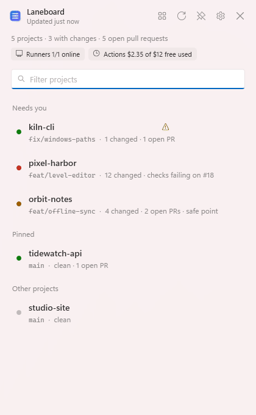
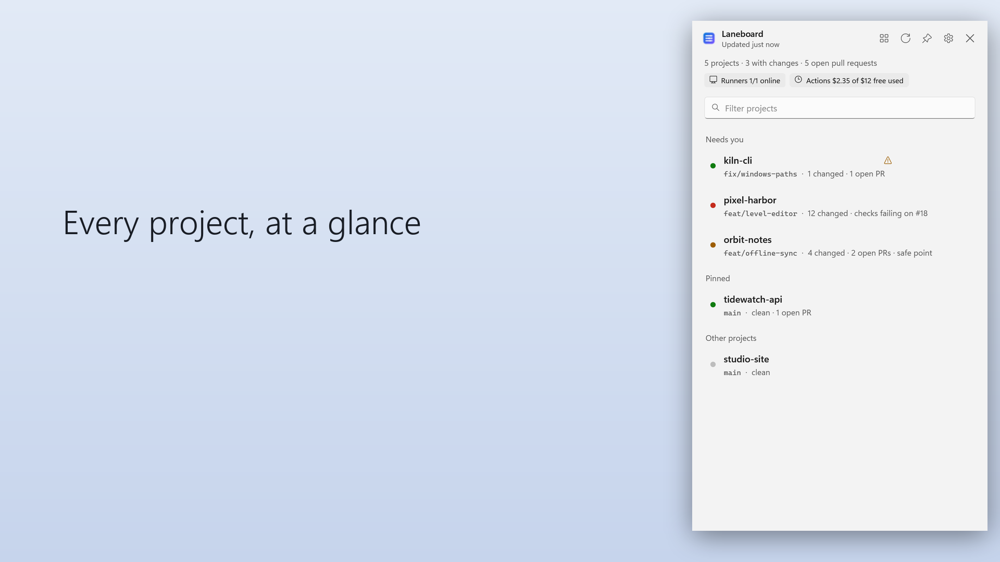
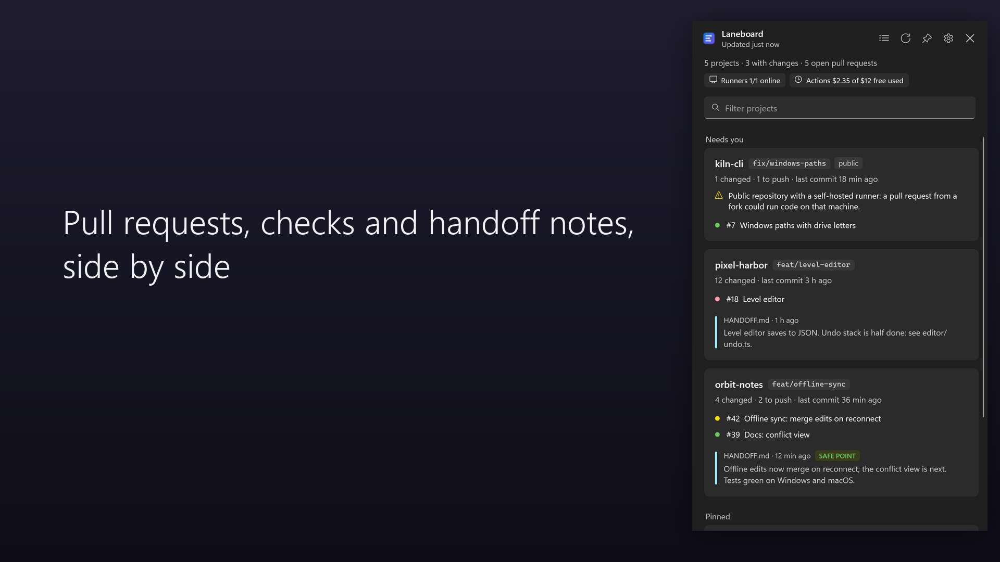

<p align="center">
  
</p>

<h1 align="center">Laneboard</h1>

<p align="center">
  Every project you're working on, at a glance.<br>
  A native Windows 11 app in the notification area: branches, changes, pull requests, checks and handoff notes
  for every Git repository on your PC, one click away.
</p>

<p align="center">
  
</p>

## What it shows

- **Every Git repository** in the folders you choose (two levels deep): the branch, uncommitted changes, commits
  to push or pull, the last commit.
- **Pull requests and their checks**, repository visibility and self-hosted runners, read through your own
  [GitHub CLI](https://cli.github.com) (`gh`). Without it, Laneboard works offline with local data only.
- **Handoff notes**: the first lines of a project's `HANDOFF.md`, with a *Safe point* badge when the note says
  `SAFE POINT`, handy when you (or an AI coding agent) leave a project in a known good state.
- **What needs you comes first**: failing checks, warnings and new safe points sit at the top, the tray icon gets a
  red dot, and a Windows notification tells you what changed (you can turn notifications off).
- **GitHub Actions minutes** this month, and how much of your plan's free allowance they used. Click the chip for
  GitHub's billing page.
- **Warnings that matter**: a public repository with a self-hosted runner, or GitHub Actions starting to bill you.

<p align="center">
  
  
</p>

## How it feels

- Opens like a Windows flyout, next to the taskbar on the monitor you clicked, and updates a moment after a file
  changes: no refresh button needed.
- Two views (light rows or full cards), System, Light or Dark theme, and a glass-to-solid background.
- Keyboard first: type to filter, arrows to move, Enter opens the project (VS Code or the folder), the menu key opens
  its menu, F5 refreshes, Esc closes. Every control has a name a screen reader can say.
- Pin projects to the top, hide the ones you don't care about, and choose how often GitHub is read (2 to 30 minutes).

## Private by design

Read-only: Laneboard never writes to your repositories, stores no token, has no account, no server and no
telemetry. Its only network calls are the `gh` commands it runs under your own sign-in. Details: [PRIVACY.md](PRIVACY.md).

## Get it

A Microsoft Store release and a ready-made download are on the way ([ROADMAP.md](ROADMAP.md)). Until then, build it:
Windows 10 or 11, [Git](https://git-scm.com), the [.NET 10 SDK](https://dotnet.microsoft.com/download), and
optionally the GitHub CLI.

```bash
git clone https://github.com/makavli/laneboard && cd laneboard
bash tools/check.sh          # tests, then build/app/Laneboard.exe (one self-contained file) and the Store package
./build/app/Laneboard.exe    # first run: pick the folders that hold your projects
```

## Develop

```bash
bash tools/check.sh                                                          # the whole local gate
powershell -NoProfile -ExecutionPolicy Bypass -File tools/live_check.ps1     # the real exe on a throwaway repository
powershell -NoProfile -ExecutionPolicy Bypass -File tools/make_gif.ps1       # films docs/laneboard.gif from the demo
./build/app/Laneboard.exe --demo                                             # made-up projects, beside your own copy
./build/app/Laneboard.exe --snapshot out.png --demo [--theme light|dark] [--view light|advanced] [--settings]
```

The gate also builds the Microsoft Store package `dist/Laneboard-<version>-x64.msix` and the Store screenshots
(`store/build_msix.sh`, needs the free Windows SDK). Packaged, Laneboard starts with Windows through the package's
startup task and shows notifications under the package's name. To try the package with Developer Mode on:

```bash
powershell -Command "Add-AppxPackage -Register build/store/layout/AppxManifest.xml"
LIVE_PACKAGE=1 powershell -NoProfile -ExecutionPolicy Bypass -File tools/live_check.ps1
powershell -Command "Get-AppxPackage Laneboard* | Remove-AppxPackage"   # before the next build
```

Errors go to `%LOCALAPPDATA%\Laneboard\laneboard.log`.

## License

[MIT](LICENSE)
